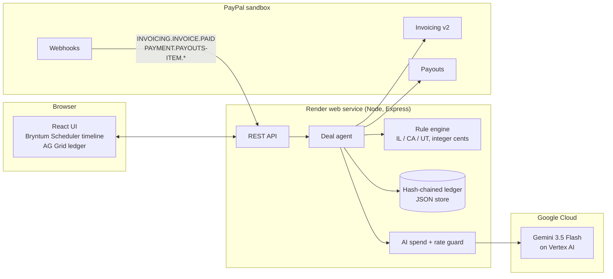

# Their Cut

**A brand pays for a family video. Their Cut watches the video and measures how much of it each child is in. It applies their state's child-influencer law, and the moment PayPal confirms the brand's payment, it moves each child's legal share into their trust. Every step goes into a record the child can read when they turn 18.**

Built with **PayPal** (Invoicing v2, Payouts, Webhooks) and **AI** (Gemini on Vertex AI for video understanding and narration analysis, plus plain-English rule explanations).

- **Live demo:** https://their-cut.onrender.com (PayPal sandbox. The free instance sleeps when idle, so the first load can take about a minute.)
- **Video:** _link added on submission_
- **Licence:** MIT

> Not legal advice; rules simplified for demo; verify with counsel.

---

## The problem

US states now require parents who earn money from family-vlog content to set aside part of it for the children who appear in it.

| State | Law | The share | Source |
|---|---|---|---|
| Illinois | SB 1782 (P.A. 103-0556), effective July 1, 2024 | A minor under 16 in at least 30% of compensated content within 30 days is owed half their content share of gross compensation (100% of the content → at least 50%) | [Fisher Phillips](https://www.fisherphillips.com/print/v2/content/36286/groundbreaking-illinois-law-protects-child-influencers-from-financial-exploitation.pdf) |
| California | SB 764, Fam. Code §§ 6650–6656, effective Jan 1, 2025 | Minors in at least 30% of content in a month, when the creator earns at least $1,250 that month: minutes share × compensation × 0.65 (§ 6652(f)) | [Statute text](https://leginfo.legislature.ca.gov/faces/billTextClient.xhtml?bill_id=202320240SB764) |
| Utah | HB 322 (2025), after Shari Franke's testimony | 15% into trust for creators earning over $150k from content with minors | [FOX 13](https://www.fox13now.com/news/politics/utah-adds-protections-for-child-influencers-following-youtuber-ruby-frankes-child-abuse-conviction) |

Illinois and California define the child's share in seconds: the share of time the child's likeness "visually appears or is the subject of an oral narrative" (Cal. Fam. Code § 6651(a)(2)). Nobody watches hours of footage with a stopwatch. Brand money arrives as invoices and platform payouts in one account, with nothing set aside automatically and no audit trail. The minor can sue later, with nothing on record.

[docs/LAWS.md](docs/LAWS.md) says exactly which numbers we checked against the statute text (California) and which come from secondary sources (Illinois, Utah). The UI flags the unverified ones.

## What it does

1. **Measure (AI).** The parent tags each child once with a reference still. Gemini watches the video at 2 fps and marks when each child is visible. A second pass transcribes the narration and marks every sentence about a child, resolving "she", "he" and "they". Result: per-child intervals, a confidence for each, and evidence (frames and quotes). The parent can drag or resize segments on the **Bryntum** timeline to correct them, and every correction goes into the audit trail.
2. **Apply the law (code, not AI).** A deterministic rule engine computes eligibility and amounts in whole cents. It covers the Illinois rolling 30-day window, California's calendar month and $1,250 floor, and the statutes' rule that several qualifying children split their combined share equally. It also flags *catch-up* amounts when a child newly crosses 30%. The LLM only explains the result. Its text is rejected if it contains any dollar figure the engine didn't produce.
3. **Move the money (PayPal).** The agent sends the brand a **PayPal invoice**. When the `INVOICING.INVOICE.PAID` **webhook** arrives (signature verified), it fires one **PayPal Payout** per child into their trust account. The `sender_batch_id` is derived from the deal, so a retry can never pay twice.
4. **Keep the record.** Every step is appended to a SHA-256 hash-chained ledger: video, presence evidence, rule applied, amounts, invoice ID, payout batch, item and transaction IDs. This is the record the statutes require, shown in an **AG Grid** ledger titled "what Mia will see at 18".

The deal **agent** runs all of this by itself and stops for the parent's approval on anything unusual: a rule not verified against statute text, a set-aside over $1,000, a child crossing the threshold, catch-up payments.

> Today it protects kids. The same engine splits earnings for any collab video, whether co-hosts, guests or brand creators, by who's actually on screen.

## Try it (judges)

1. Open https://their-cut.onrender.com. You get a private demo family (Mia, Leo and Noah) with two earlier deals pre-seeded, so the 30-day window has history. Those two moved no money and are labelled as demo history.
2. Under **New brand deal**, pick a video and click **Start the deal**. The timeline paints each child's seconds; striped bars are narration about them.
3. The agent sends a real **PayPal sandbox invoice** to the brand's sandbox account.
4. To pay it, click **Simulate brand payment (sandbox API)**. This records the payment through the Invoicing API and is labelled as a simulation everywhere. You can also open the invoice as the brand in the PayPal sandbox if you have the sandbox buyer login.
5. Click **Approve and continue**. Payouts fire to each child's trust account, and their PayPal transaction IDs appear live.
6. Open **Mia's ledger** for the AG Grid record, or download the full deal record as JSON from the deal page.

Use the state tabs on the deal page to compare what the same video owes under Illinois, California and Utah law.

## Architecture



| Piece | Where |
|---|---|
| Rule engine and tests | [server/rules/](server/rules/), [server/test/engine.test.ts](server/test/engine.test.ts) |
| Presence analysis (Gemini) | [server/analysis/presence.ts](server/analysis/presence.ts), [server/analysis/gemini.ts](server/analysis/gemini.ts) |
| Deal agent | [server/agent.ts](server/agent.ts) |
| PayPal client | [server/paypal.ts](server/paypal.ts) |
| Ledger | [server/store.ts](server/store.ts) |
| UI | [web/src/](web/src/) |
| Eval | [server/eval/](server/eval/) |

### PayPal APIs used

- `POST /v2/invoicing/invoices`, `/send`, `GET /v2/invoicing/invoices/{id}`, `/payments` (sandbox simulation only)
- `POST /v1/payments/payouts`, `GET /v1/payments/payouts/{batch_id}`
- `POST /v1/notifications/verify-webhook-signature`, plus webhooks for `INVOICING.INVOICE.PAID` and `PAYMENT.PAYOUTS*`
- `POST /v2/checkout/orders` with several `purchase_units` payees, tested as a fallback split (see [docs/SPIKES.md](docs/SPIKES.md))

## Accuracy

`npm run eval` scores the analysis against hand-built ground truth on all three demo videos (9 child × video pairs). Full table: [docs/EVAL.md](docs/EVAL.md).

| Metric | Result |
|---|---|
| Per-child presence error (mean absolute) | **1.22 percentage points** |
| Narration subject detection, precision / recall | **1.00 / 1.00** (12 of 12 lines, including pronoun-only lines) |
| Interval IoU | 0.86–0.92 on the longer videos; 0.50 on a 3-second shot |

Gemini's timestamps run about 1 s early. That barely moves the percentages that set the money, but it halves the IoU on very short shots. We report this as measured and don't apply a correction fitted to the eval set.

## Privacy and ethics

- **No face recognition against outside databases.** Matching happens only inside one video, against the parent's own reference stills. No biometric templates are stored. This was designed with Illinois's BIPA in mind.
- **No real children's footage.** The demo uses licensed Pexels stock footage of one family; see [ASSETS.md](ASSETS.md). The names Mia, Leo and Noah are fictional labels.
- **The AI never decides money.** Amounts come from tested code, and the AI's explanation is rejected if it invents a figure.
- **The parent is in the loop.** The agent pauses on anything unusual, and every correction to the measurement is recorded next to the original.

## Running it yourself

Requirements: Node 22+, a PayPal developer account (sandbox), and either a Google Cloud project with Vertex AI or a Gemini API key.

```bash
npm install
cp .env.example .env   # fill in sandbox credentials, see below
npm run build          # builds the web app
npm start              # http://localhost:8787
```

`.env` needs:
- a PayPal sandbox app's client ID and secret, with **Invoicing** and **Payouts** turned on;
- sandbox account emails: one business account (the creator), one personal account (the brand), and one personal account per child's trust;
- `GOOGLE_CLOUD_PROJECT` (Vertex AI, using your `gcloud auth login` locally) or `AI_BACKEND=aistudio` with `GEMINI_API_KEY`;
- optionally `BRYNTUM_LICENSE_KEY`. Without it the timeline runs in trial mode.

Webhooks need a public URL. Register `https://<host>/api/webhooks/paypal` and set `PAYPAL_WEBHOOK_ID`. Without webhooks, a background poller picks up paid invoices and payout statuses.

Other commands:
- `npm test`: rule engine tests.
- `npm run eval`: re-runs Gemini on the demo videos and scores them. `-- --cached` scores the saved results without calling the AI.
- `npx tsx scripts/smoke.ts http://localhost:8787 --pay`: the whole flow through the API.
- `npx tsx scripts/build-fixtures.ts`: rebuilds the demo videos and ground truth (needs Windows and ffmpeg).

**Cost controls.** Flash-tier models only. AI calls are capped at 20 per hour and 60 per day across all visitors, live re-analysis at 2 per visitor per day, and spend at a configurable daily and total dollar cap. When a cap is hit, the app falls back to the saved measurement and template explanations.

**Hosting.** One free Render web service (`render.yaml`). Analysis results for the demo videos are cached in the repo, so the hosted demo is instant and costs nothing unless someone asks for a fresh AI run.

## Limitations

- Illinois and Utah figures are not yet checked against the statute text (the state sites were unreachable when building). They are flagged in the UI.
- Brand deals are treated as compensation for the video, and the per-view test (≥ $0.10/view or the platform's threshold) is treated as met.
- Accuracy is measured on three demo videos of one family. That shows the method works, not that it generalises.
- The free Render disk is ephemeral, so demo workspaces reset when the service restarts. A real deployment would use a database.
- Live analysis takes inline videos up to 14 MB and 3 minutes.
- Sandbox only. A real deployment needs real trust accounts at an insured institution, as the statutes require.

## Licences

Code: MIT ([LICENSE](LICENSE)). Demo footage: Pexels License ([ASSETS.md](ASSETS.md)). Bryntum Scheduler (trial) and AG Grid Community are used under their own licences.
